**English** | [简体中文](README.md)

**▶ [Play in browser](https://mjhuang666.github.io/deep-cat/)** · [Download the single file](DeepCat-20261115-032953.html)

# Deep Cat

> 《深度求猫》 — a play on DeepSeek's Chinese name, 深度求索.

A made-in-China AAA-style game built entirely with DeepSeek v4.1 Flash.

A single-file first-person shooter level playable directly in your browser: dusk, light rain, four interconnected alleys, a container yard and a seaside sunset. Fight your way from the neon-lit streets to the seaside boss, the Tide Beast.

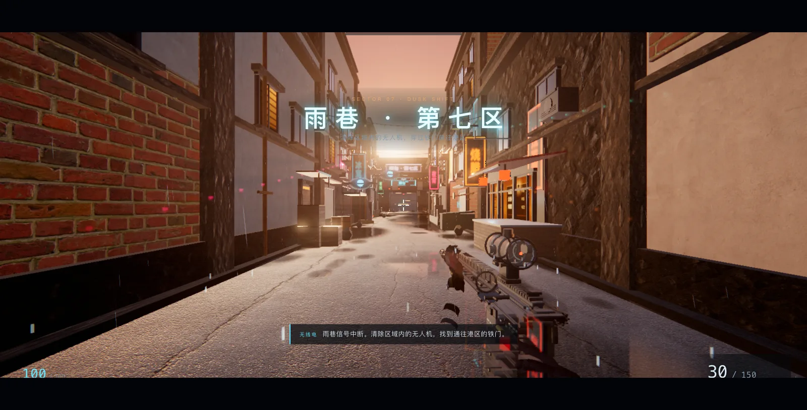

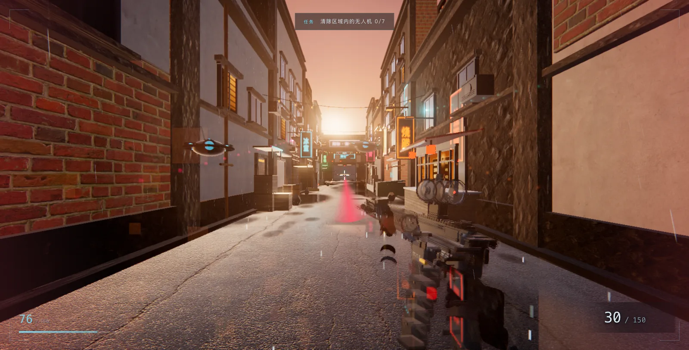

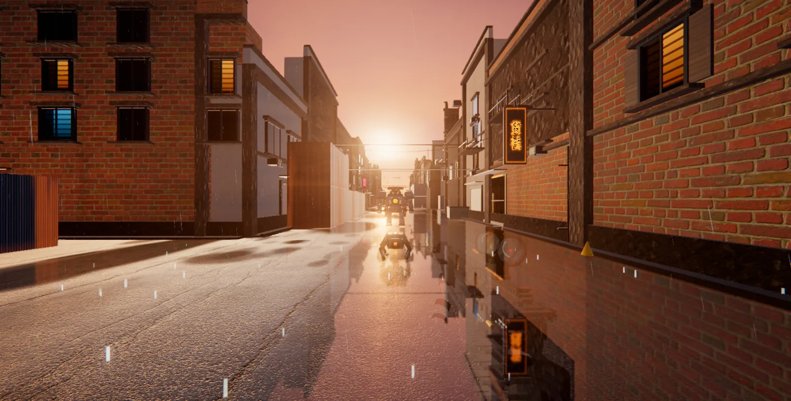

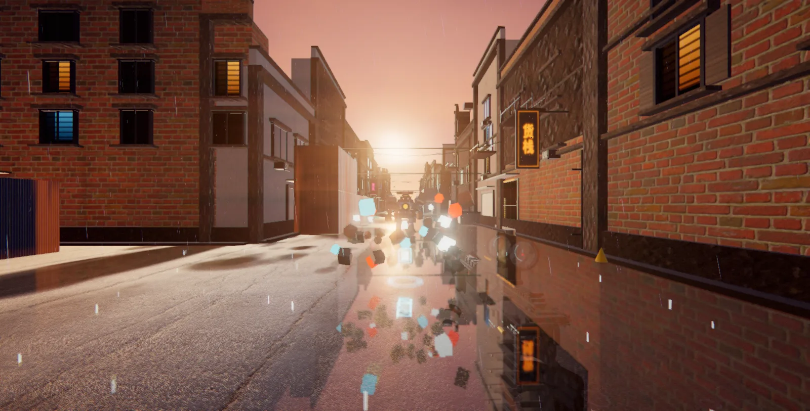

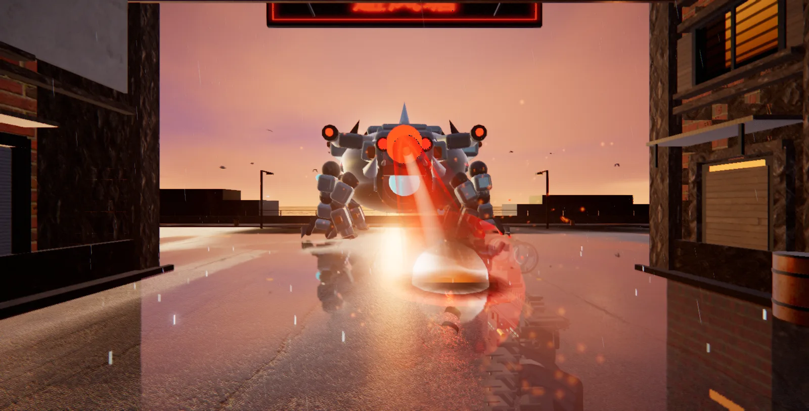

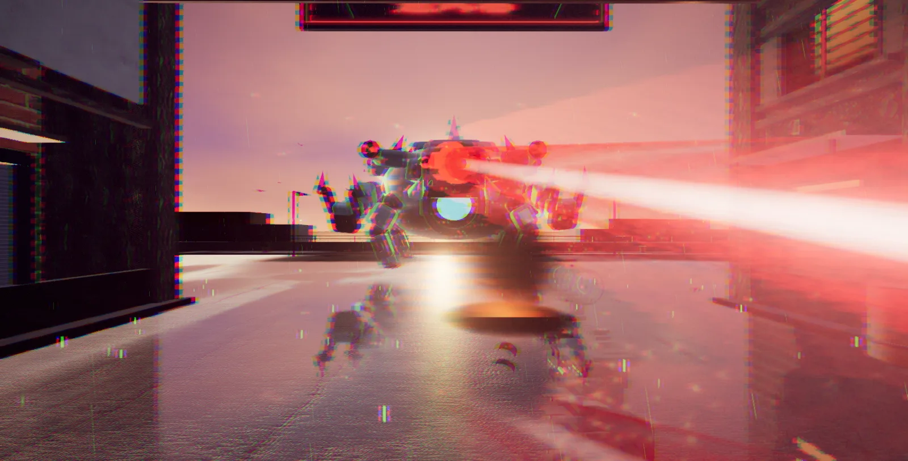

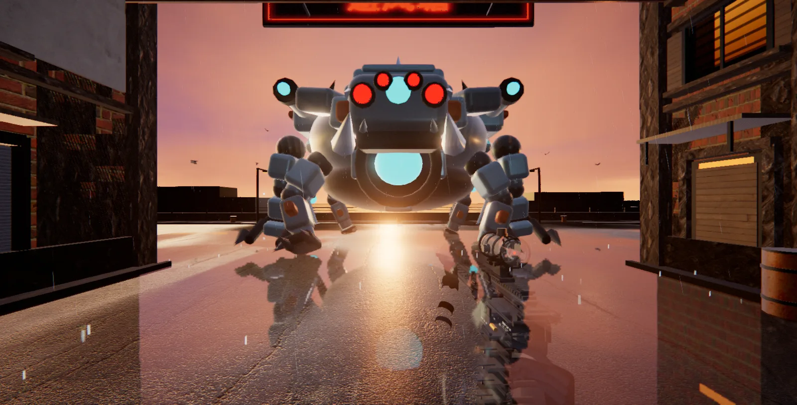

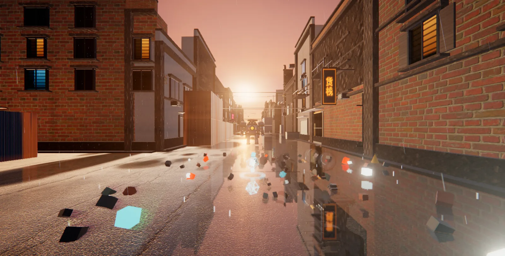

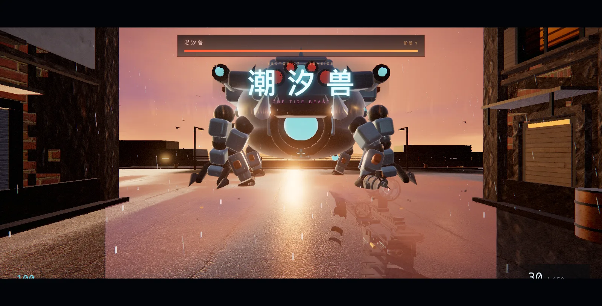

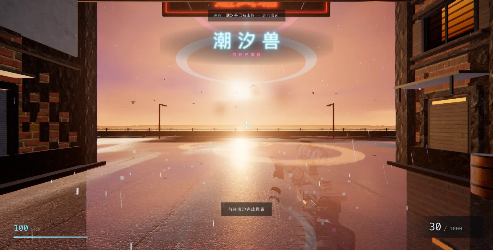

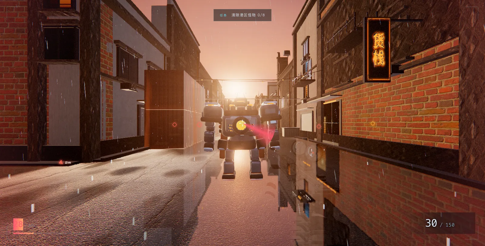

## Made entirely with OpenCode + DeepSeek v4.1 Flash

Every visual, sound effect, lighting setup and animation is generated by DeepSeek. Total production cost: under $5.

## Built from the original Saltline prompt

1. Make me a first-person shooter.
2. The visuals should be absurdly detailed — close to AAA quality.
3. Keep the scope small, e.g. a single level, but make the visuals stunning and photorealistic.
4–N. Fine-tune and optimize.

## Creative intent

Fable 5.2's Saltline recently went viral, and its results were stunning. I was curious whether the Chinese model DeepSeek v4.1 Flash could reach that level and compete with Fable. In practice, there is still a noticeable gap, but the result is solid — a bit better than I expected, especially for a Flash model. Keep it up, Liang Sheng!

## Play now

**Play in browser:** https://mjhuang666.github.io/deep-cat/

Or download and open:

**[DeepCat-20261115-032953.html](DeepCat-20261115-032953.html)**

No installation, no internet connection, and no local server required. The latest Chrome / Edge is recommended. The browser and download versions are identical.

- File size: 6,868,284 bytes
- SHA-256: `d773a8401af0badde8636a6b2c7219d9d4d6645c0b1a346a1588b11957c16b7b`

## Controls

| Key | Action |
| --- | --- |
| WASD | Move |
| Shift | Sprint |
| Space | Jump |
| Left mouse button | Fire |
| Right mouse button | Aim down sights |
| R | Reload |
| Esc | Pause |

## Features

- Three drone waves → container-yard ground enemies → seaside boss “Tide Beast” → extraction
- 30-round magazine with 150 reserve rounds; kills drop ammo/health and damage falls off beyond 20 m
- Cyclops-style boss laser: a white-hot core with a red halo fires from the face, slams the ground with sparks, scorch and black smoke, then rises over the boss into the distant sky; 6 m ground blast; off-screen enemy direction markers
- Boss kill sequence: slow motion, shockwaves, energy pillar, rising energy rings, delayed detonations, kill banner and dedicated sound design
- Three procedural music layers: ambient pad / combat pulse / boss dissonance
- Settings: mouse sensitivity, FOV, master volume, invert Y, screen shake, radio subtitles (saved locally)
- Boss-checkpoint retry; S/A/B/C rating, score and local best on victory
- Cinematic boss intro with letterbox, four procedural tentacles and a wet clearcoat carapace
- Soft contact shadows under every enemy, enemy bodies reflected in puddles, contact shadows excluded from the mirror pass, instanced death debris and SMAA anti-aliasing
- TAA temporal accumulation + camera motion blur; high/medium use TAA + SMAA
- Small-enemy kill: cyberpunk voxel shatter (46–70 metal/neon cubes with gravity, ground bounce, spin and settle/fade), 0.09s slow motion, camera shake, RGB split and a digital shatter sound; no double-ring explosion
- F-key weapon inspect and enemy hit recoil; small enemies shatter into cyberpunk voxel cubes
- First-kill prewarm for instance colors, voxel and scorch materials removes the first-kill hitch
- Mission intro card + radio subtitles/chatter; cargo gantry, floodlight tower and distant ships
- New street clutter (bags, boxes, pallets, cones, pipes, AC units) across the main street
- All assets embedded; runs offline as a single file

## Notes

This is a build artifact. The source repository is not public yet.
