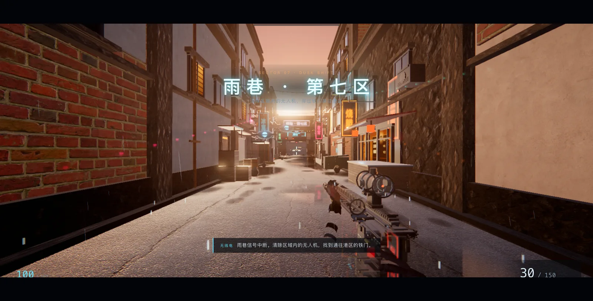
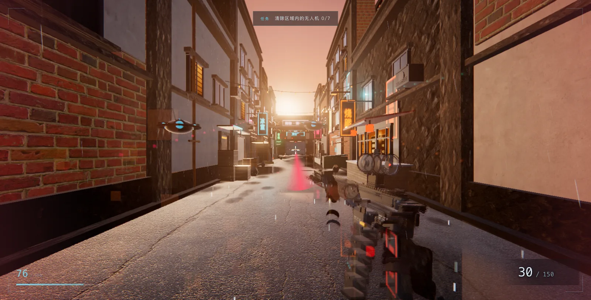
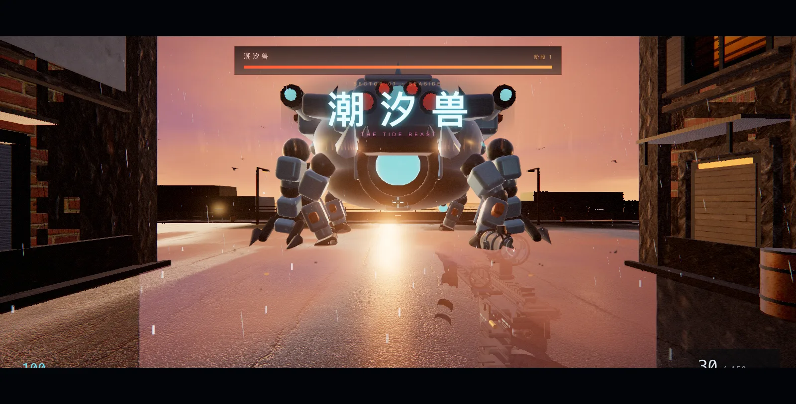
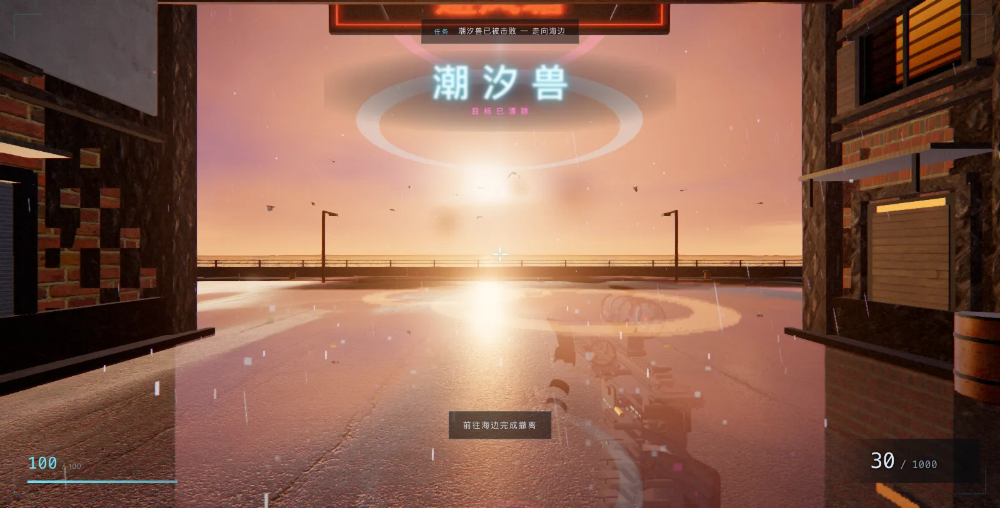
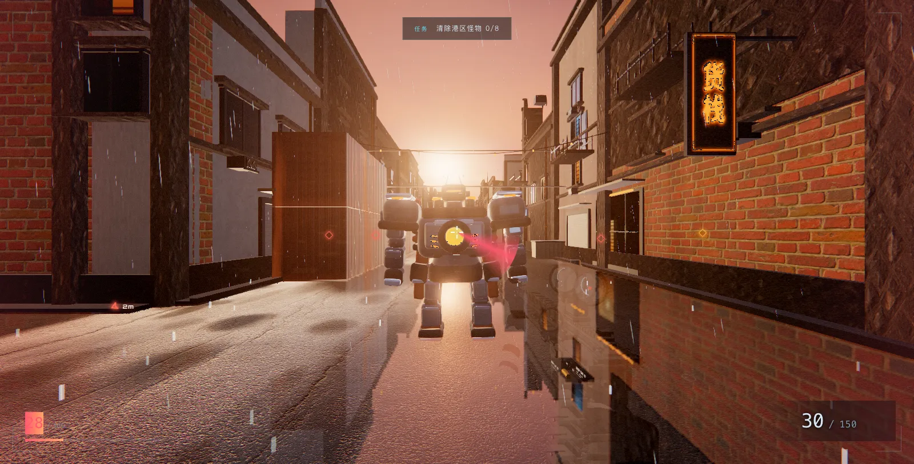

[English](README.en.md) | **简体中文**

**▶ [在线试玩](https://mjhuang666.github.io/deep-cat/)** · [下载单文件](DeepCat-20261115-005305.html)

# Deep Cat — 《深度求猫》

一款全程由DeepSeek v4.1 Flash制作的国产3A作品

可直接在浏览器中游玩的单文件第一人称射击关卡：黄昏、小雨、四条互通巷道、集装箱货场与海边日落，从霓虹街区一路打到海边 Boss「潮汐兽」。

## 全程由OpenCode + DeepSeek v4.1 Flash 制作
所有画面，音效，光影，动作，均由deepseek生成，制作成本不到5刀。

## 沿用《Saltline》原始提示词
1，你给我做一个第一人称射击游戏吧。
2，画质要细到离谱，看上去要跟得上3A。
3，范围小一点，比如一小关，但画面要够惊艳、够写实。
4～N，微调优化。

## 创作意图
最近由Fable 5.2 制作的《Saltline》火遍全网，效果令人赞叹，
所以我好奇国产模型DeepSeek v4.1 Flash，能达到怎样的水平，能否与Fable一战
实测下来，差距还是有不少，但效果也不错，有点小超预期，毕竟这还是个Flash模型啊，梁圣加油！

## 直接游玩

**在线试玩：** https://mjhuang666.github.io/deep-cat/

或下载并双击打开：

**[DeepCat-20261115-005305.html](DeepCat-20261115-005305.html)**

无需安装、无需联网、无需本地服务器。建议使用最新版 Chrome / Edge。在线版与下载版内容一致。

- 文件大小：6,855,677 字节
- SHA-256：`06629236603ea2f37bc73f820711d7848fe349e9a582e14bba519d5d5a57682f`

## 操作

| 按键 | 功能 |
| --- | --- |
| WASD | 移动 |
| Shift | 冲刺 |
| 空格 | 跳跃 |
| 鼠标左键 | 射击 |
| 鼠标右键 | 开镜 |
| R | 换弹 |
| Esc | 暂停 |

## 内容

- 三波无人机 → 港区地面怪 → 海边 Boss「潮汐兽」→ 撤离
- 弹匣 30 发，备弹 150 发；击杀掉落弹药/医疗包，20m 外伤害逐步衰减
- 科幻等离子激光 Boss、屏幕外敌人方向指示
- Boss 击杀演出：慢动作、冲击波、能量光柱、上升能量环、延迟爆点、击杀横幅与专属音效
- 程序化 3 层音乐：环境 pad / 战斗脉冲低音 / Boss 不协和层
- 设置面板：鼠标灵敏度、FOV、主音量、反转 Y、镜头震动、无线电字幕（本地保存）
- Boss 战死亡可从 Boss 前重试；胜利结算 S/A/B/C 评级、得分与本地最佳纪录
- Boss 登场 letterbox 名称卡、4 条程序化触手、湿滑 clearcoat 甲壳
- 所有敌人脚下有软接触阴影，击杀爆出实例化碎片；SMAA 抗锯齿
- TAA 时域累积 + 相机运动模糊；high/medium 为 TAA+SMAA
- 第一人称腿部、F 检视武器、敌人受击后仰与 0.5s 死亡坍塌
- 开局任务卡 + 无线电字幕/chatter；港区吊机、灯塔与远处船影
- 主街新增垃圾袋/纸箱/托盘/锥桶/落水管/空调外机，提升全街道密度
- 单文件离线运行

## 说明

这是构建产物，源码仓库暂未公开。
